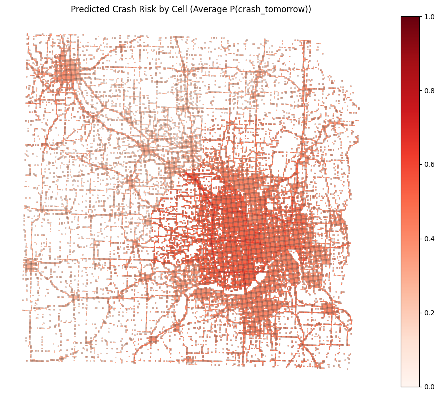

# Traffic Crash Prediction Project

## Project Overview

This project focuses on predicting traffic crash hotspots in the Twin Cities metro area of Minnesota. Specifically, we aim to predict whether a specific city grid cell will experience at least one traffic crash on the following day ($t+1$) based on historical crash data and weather conditions. The analysis is refined to focus exclusively on the Minneapolis-St. Paul metropolitan region rather than the entire state.

## Motivation 

Road safety is a critical public health issue. By identifying high-risk areas in advance, city planners and emergency services can allocate resources more effectively. This project applies core data-mining skills—including feature engineering, handling imbalanced classification, and temporal risk assessment—to a complex real-world problem.

## Data

### Datasets
- **Minnesota Crash Data**: Historical police crash logs from the Twin Cities metro area containing location (GPS), timestamp, roadway types, and environmental conditions at the time of the incident. Data was filtered to focus on the Minneapolis-St. Paul metropolitan region.
- **NOAA Weather Data**: Daily summaries from the Minneapolis-St. Paul weather station providing temperature (TAVG/MAX/MIN), precipitation (PRCP), snowfall (SNOW), and atmospheric conditions (fog, ice, wind, etc.).

### Preprocessing & Grid Generation
- **Geographic Focus**: The dataset was refined to include only crashes within the Twin Cities metropolitan area (Minneapolis-St. Paul region), excluding the rest of Minnesota.
- **Spatial Discretization**: We divided the Twin Cities metro area into a 500m x 500m grid. Each crash incident is mapped to a specific `cell_id`.
- **Temporal Aggregation**: Data is aggregated into "cell-days," creating a balanced time-series structure where each row represents a unique cell and a unique date.
- **Labeling**: For each grid cell on day $t$, the label is 1 if $\ge 1$ crash occurred on day $t+1$, and 0 otherwise.

## Models

We implemented and compared several modeling approaches:

1. **Random Forest Classifier**:
   - Uses a balanced class weight strategy to handle the rarity of crash events.
   - Includes categorical features like Roadway Type, Region, and Surface Conditions.
   - Features importance analysis to identify key risk drivers.

2. **Artificial Neural Network (MLP)**:
   - A Multi-Layer Perceptron (MLP) architecture with multiple hidden layers (64, 32).
   - Trained on scaled numeric features and one-hot encoded categorical data.
   - Evaluated using probabilistic metrics like Brier Score and Log-loss.

## Results

Our models were evaluated using a temporal split, training on data through 2023 and validating on 2024+ data.

### Performance Summary

| Metric | Random Forest | ANN (MLP) |
| :--- | :--- | :--- |
| **ROC AUC** | 0.6653 | 0.6915 |
| **Brier Score** | — | 0.0498 |
| **Log-loss** | — | 0.1988 |
| **PR-AUC (Avg Precision)** | — | 0.1178 |
| **Hit-rate@k (k=500)** | — | 0.1840 |
| **Sensitivity (Recall)** | 0.5757 | 0.0012 |
| **Specificity** | 0.6481 | 0.9998 |

### Key Takeaways

- The **ANN (MLP)** achieved a slightly higher ROC AUC (0.6915 vs. 0.6653) and demonstrates excellent calibration (low Brier Score and Log-loss), making it the stronger choice for probability-based risk ranking.
- The **Random Forest** delivers strong **sensitivity of 57.57%**, catching more than half of actual crash events, making it ideal for scenarios requiring maximum recall and early warning.
- The Random Forest achieves a balanced trade-off with **specificity of 64.81%**, providing actionable alerts without excessive false positives.
- Both models show practical value: with ~2,369 true positives and only 1,746 false negatives in the test set, the Random Forest successfully identifies the majority of crash-prone days while maintaining reasonable precision (9% positive predictive value).
- The rarity of crash events (positive rate ~5.4%) makes this a challenging imbalanced classification problem, explaining why even the best models achieve moderate ROC AUC scores.
- **Confusion Matrix Insight**: The Random Forest correctly identifies 2,369 crash days out of 4,115 total crashes (57.57% sensitivity), with 25,388 false alarms but protecting 46,754 true negatives from unnecessary alerts.

### Spatial Risk Visualization

The Random Forest model generates a geographic heatmap showing predicted crash risk across the Twin Cities metro area:

**Interpretation**: 
- **Dark red regions** (probability ~0.4–1.0) represent high-risk areas with elevated crash probability
- **Light pink/white regions** (probability ~0.0–0.2) represent low-risk areas
- The darker concentration in **central Minneapolis-St. Paul** reflects higher traffic density, more intersections, and greater crash frequency
- This map enables targeted resource allocation (increased patrol, safety campaigns) in predicted high-risk zones
- **Confusion Matrix Insight**: The Random Forest correctly identifies 2,369 crash days out of 4,115 total crashes (57.57% sensitivity), with 25,388 false alarms but protecting 46,754 true negatives from unnecessary alerts.

## Project Structure

- `notebooks/`: Contains the end-to-end pipeline (Preprocessing, Exploration, and Model-specific notebooks).
- `src/`: Core Python modules for `preprocessing.py` and `modeling.py`.
- `data/`: Raw and processed datasets (ignored by Git due to size).

## Group Members

* Adam Meyers
* Rehan Ahmad
* Ian Corsiga
* Jeffrey Qian
* Clayton Sparrow
